# sysketch

[](https://www.npmjs.com/package/sysketch) [](https://www.npmjs.com/package/sysketch-mcp) [](https://github.com/Tonys-Coding/sysketch/actions/workflows/ci.yml) [](LICENSE)

**Polished system design diagrams from a few lines of YAML.** Your AI writes a tiny spec; a deterministic renderer draws the diagram. The AI never writes SVG, so a diagram costs tens of tokens instead of thousands, and every diagram comes out in the same clean style.

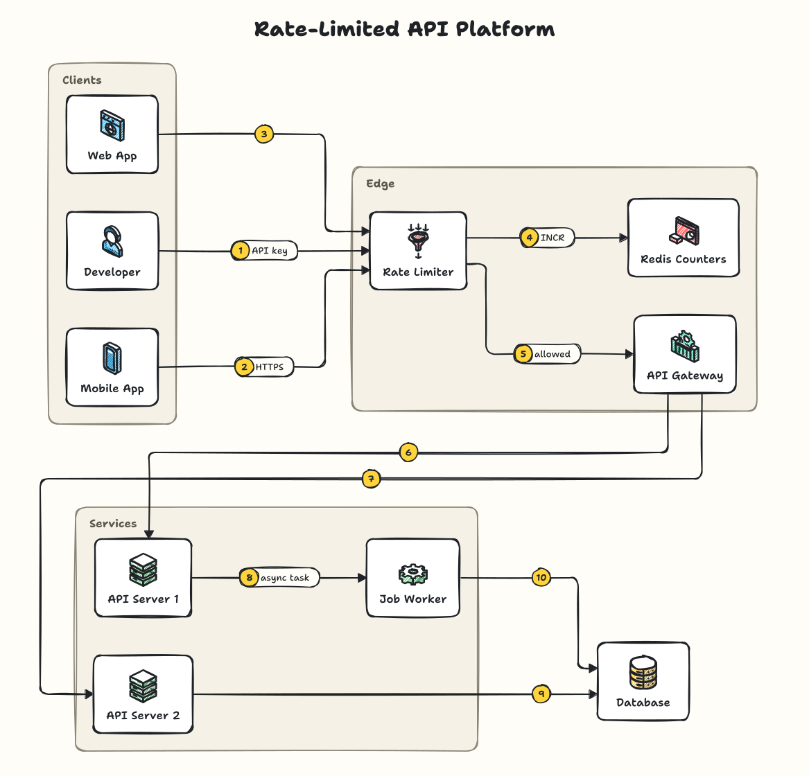

That diagram is this spec (618 characters):

```yaml
title: Rate-Limited API Platform
nodes:
  dev: user | Developer
  app: mobile | Mobile App
  web: browser | Web App
  limiter: rate-limiter | Rate Limiter
  gw: api-gateway | API Gateway
  counters: redis | Redis Counters
  api1: server | API Server 1
  api2: server | API Server 2
  jobs: worker | Job Worker
groups:
  Clients: [dev, app, web]
  Edge: [limiter, gw, counters]
  Services: [api1, api2, jobs]
edges:
  - dev > limiter | API key
  - app > limiter | HTTPS
  - web > limiter
  - limiter > counters | INCR
  - limiter > gw | allowed
  - gw > api1
  - gw > api2
  - api1 > jobs | async task
  - api2 > db
  - jobs > db
```

## Why sysketch

Asking an AI to draw a diagram usually means it writes the whole SVG: every coordinate, path and color, every time. sysketch moves all of that into a renderer.

Measured with Claude Code (Sonnet) on 5 system design requests plus one follow-up edit each ([full benchmark](docs/benchmark.md)):

|                                    | AI writes SVG | AI uses sysketch | Difference      |
| ---------------------------------- | ------------- | ---------------- | --------------- |
| Output tokens, creating 5 diagrams | 77,518        | **4,352**        | **18x fewer**   |
| Output tokens, 5 edits             | 28,919        | **7,746**        | 3.7x fewer      |
| Cost, all 10 runs                  | $2.44         | **$0.95**        | 2.6x cheaper    |
| Time to create a diagram           | ~99 s         | **~11 s**        | about 9x faster |

- **Cheap:** icons, layout, arrows and styling cost zero AI tokens.
- **Consistent:** same spec in, byte-identical SVG out. Every diagram matches.
- **Editable:** the spec is the source of truth. Change one line, re-render.
- **Portable:** text is drawn as vector paths, so diagrams look identical in browsers, GitHub, Notion, Figma, slides and PNG.
- **Forgiving:** short, fixable errors like `unknown node "databse". Did you mean: database?`

## Quick start

No install needed (Node 20+). Write a spec:

```yaml
# diagram.yaml
title: URL Shortener
groups:
  Backend: [api, cache, db]
edges:
  - client > lb | POST /shorten
  - lb > api
  - api > cache
  - api > db
```

Render it:

```bash
npx sysketch render diagram.yaml -o diagram.svg
```

More options:

```bash
npx sysketch render diagram.yaml --png --scale 2       # high-res PNG
npx sysketch render diagram.yaml --theme sketch        # pick a theme
npx sysketch icons                                     # list icons + aliases
```

Or install it as a dependency: `npm install sysketch` (see [library usage](#how-it-works)).

## Use it from Claude Code, Claude Desktop or Cursor (MCP)

sysketch ships an MCP server, [`sysketch-mcp`](https://www.npmjs.com/package/sysketch-mcp), so your AI can draw diagrams directly.

**Claude Code:**

```bash
claude mcp add sysketch -- npx -y sysketch-mcp
```

**Claude Desktop, Cursor and other MCP clients** (add to the MCP config):

```json
{
  "mcpServers": {
    "sysketch": { "command": "npx", "args": ["-y", "sysketch-mcp"] }
  }
}
```

Then just ask: _"Use sysketch to diagram a ride-sharing system, as a PNG."_ The AI writes a short spec, the server writes the files, and only a one-line summary comes back into the conversation:

```
wrote diagrams/ride-sharing.png (4564x984, 8 nodes, 10 edges, 259.8 KB); spec: diagrams/ride-sharing.yaml
```

The spec is saved next to the diagram, so follow-up edits are one-line changes. Tools: `render_diagram` (`spec` or `file`, optional `out` as .svg/.png, `theme`, `preview`) and `list_icons`. The tool definitions add about 360 tokens per session.

## Spec reference

| Key         | Meaning                                                                                                                                                           |
| ----------- | ----------------------------------------------------------------------------------------------------------------------------------------------------------------- |
| `title`     | Optional heading                                                                                                                                                  |
| `nodes`     | `id: icon`, `id: icon \| Label` or `id: icon \| Label \| subtitle`. Optional: an icon name or alias used in an edge creates the node for you                      |
| `groups`    | `Label: [node ids]` draws a labeled container                                                                                                                     |
| `edges`     | `a > b`, `a > b > c`, `a > b \| label` (label on the last hop). `a ..> b` is dashed (responses, async); a trailing `[red]` or `[green, dashed]` colors the arrows |
| `theme`     | `graphite` (default), `blueprint`, `midnight`, `classic`, `sketch`                                                                                                |
| `steps`     | `false` hides the numbered step badges (default: numbered in edge order)                                                                                          |
| `legend`    | `true` adds a numbered list of the steps under the diagram                                                                                                        |
| `logos`     | `./folder` adds a folder of your own logo files; `false` turns brand logos off (see [Official brand logos](#official-brand-logos))                                |
| `direction` | `right` or `down`. Leave it out and sysketch uses `right`, switching to `down` when that gives a more readable shape                                              |

The smallest useful spec is one line, because aliases create nodes automatically:

```yaml
edges: ['client > lb > api > db']
```

Aliases include `client`, `lb`, `api`, `db`, `redis`, `kafka`, `s3`, `postgres`, `lambda`, `k8s` and many more; run `npx sysketch icons` for the full list.

## Subtitles, arrow styles and step legends

Add detail without adding much to the spec: a subtitle line under a node, dashed arrows for responses, colored arrows for different paths, and a numbered legend.

```yaml
title: 'URL Shortener: Read Path'
legend: true
nodes:
  lb: load-balancer | Load Balancer | round robin
  api: server | API Server | stateless, 3 replicas
  cache: redis | Redis | cache-aside, TTL 24h
  db: postgres | PostgreSQL | source of truth
groups:
  Backend: [api, cache, db]
edges:
  - client > lb | GET /abc123
  - lb > api
  - api > cache | lookup [green]
  - api > db | on miss [amber]
  - api ..> client | 302 redirect [blue]
```

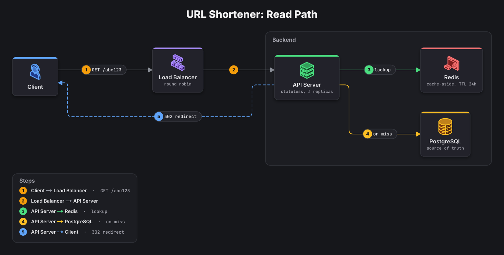

Colors: `blue`, `green`, `amber`, `red`, `violet`, `teal`, `pink`, `sky`, `orange`, `slate` (also `yellow`, `purple`, `cyan`, `gray`). Values containing `: ` (like the title above) are quoted automatically if you forget.

## Themes

| Graphite (default)                    | Blueprint                               | Midnight                              | Classic                             | Sketch                            |
| ------------------------------------- | --------------------------------------- | ------------------------------------- | ----------------------------------- | --------------------------------- |
| 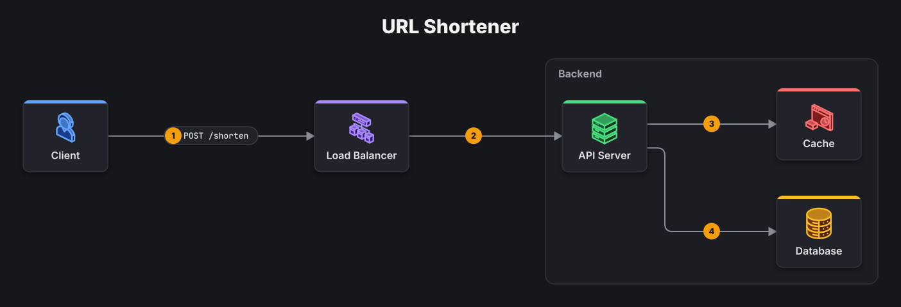 | 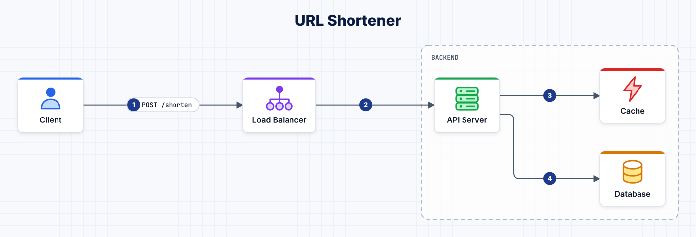 | 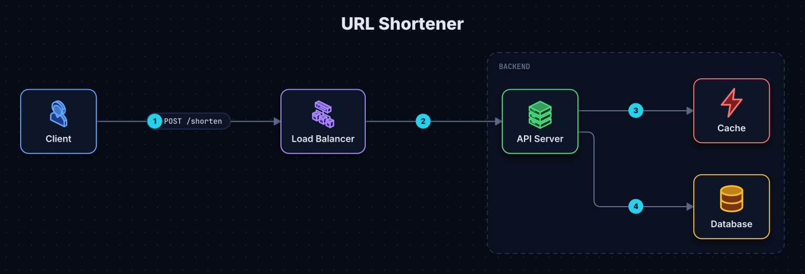 | 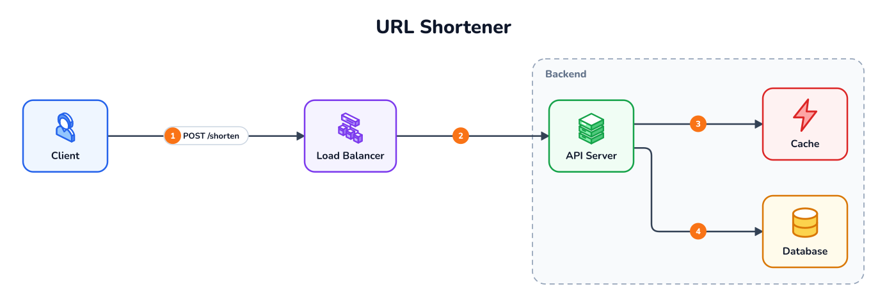 | 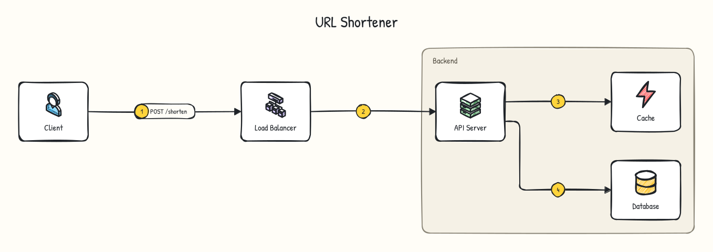 |

Themes are pure data (colors, fonts, card style, shadows, texture), so adding one never touches the renderer. The sketch theme redraws everything hand-made with rough.js.

## Icons

A complete set of **61 original isometric icons**, recolored automatically for every theme and covering clients, edge, compute, data, messaging, security, observability, AI and infrastructure. More than 160 aliases (`redis`, `kafka`, `s3`, `lambda`, `k8s`...) map onto them.

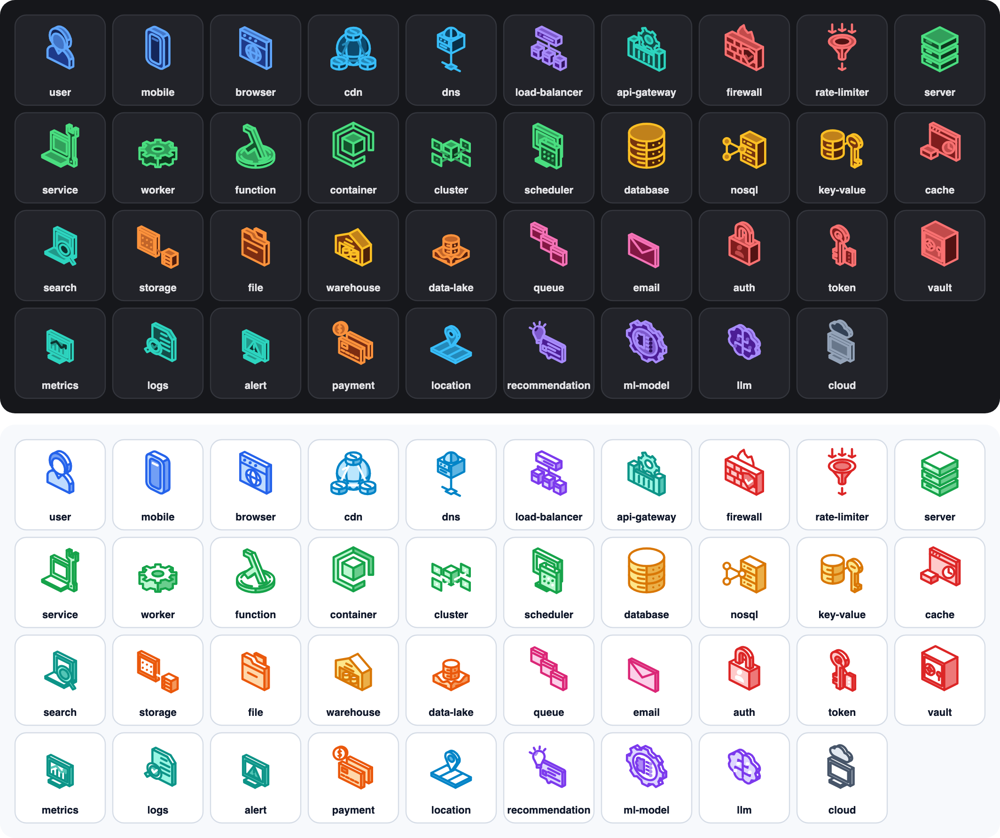

Full list: [docs/icon-checklist.md](docs/icon-checklist.md). Want to draw or restyle icons? The style guide and a ready-to-use AI prompt are in [docs/isometric/GUIDE.md](docs/isometric/GUIDE.md). Drop an SVG into `icons-src/` and run `npm run icons`; it validates the file, converts it, and renders a preview of every icon in every theme.

## Official brand logos

sysketch can draw the **official logo** of a product (Stripe, PostgreSQL, Amazon S3, Azure Cosmos DB, BigQuery...) instead of the generic icon, unedited: the original file, scaled evenly on a neutral tile, with no recoloring, 3D effect or hand-drawn roughening. Logos cost the AI nothing extra: it still writes `stripe` or `s3`, and sysketch looks the name up on your machine.

sysketch ships **no logos**. You install them yourself from the official sources, and they are stored in `~/.sysketch/logos` (or `$SYSKETCH_HOME/logos`), outside your projects:

```bash
npx sysketch logos install simple-icons             # ~3,400 brand marks from the Simple Icons npm package
npx sysketch logos import ~/Downloads/Icon-package_07312026.zip   # a cloud icon pack you downloaded
npx sysketch logos find s3                           # search what is installed
npx sysketch logos info stripe                       # license, brand guidelines and original artwork link
```

### Cloud icon packs

AWS, Azure and Google Cloud publish their own architecture icons for diagrams. Download them from the vendor (each page states its terms), then import the `.zip` as it is; sysketch detects the vendor and file names:

| Vendor       | Where to download                                                                                                  | Then                                                           |
| ------------ | ------------------------------------------------------------------------------------------------------------------ | -------------------------------------------------------------- |
| AWS          | [AWS Architecture Icons](https://aws.amazon.com/architecture/icons/), "Download the asset package"                 | `npx sysketch logos import <Icon-package_*.zip>`               |
| Azure        | [Azure icons](https://learn.microsoft.com/en-us/azure/architecture/icons/), accept the terms, "Download SVG icons" | `npx sysketch logos import <Azure_Public_Service_Icons_*.zip>` |
| Google Cloud | [Google Cloud icons](https://cloud.google.com/icons), "Core products" zip                                          | `npx sysketch logos import <core-products-icons.zip>`          |

After that, everyday names work: `s3`, `lambda`, `sqs`, `eks`, `route53` (AWS); `aks`, `cosmosdb`, `keyvault`, `servicebus` (Azure); `bigquery`, `cloudrun`, `gke`, `spanner` (Google Cloud). Re-import a newer pack the same way to update it.

### Company logos

A company can keep its approved logo files next to its specs and add `logos: ./brand` to the spec (or pass `--logos ./brand`). `npx sysketch logos lock ./brand` records a fingerprint of every file, and edited files are refused from then on.

### Names

| Name in the spec                    | Result                                                              |
| ----------------------------------- | ------------------------------------------------------------------- |
| `database`, `queue`, `api`, `cdn`   | Generic names always use the sysketch icon                          |
| `redis`, `s3`, `stripe`, `sendgrid` | The official logo if installed, otherwise a fitting sysketch icon   |
| `acme/queue`                        | Acme's logo if installed, otherwise the `queue` icon labeled "Acme" |

About 230 product names are recognized without any logos installed (`npx sysketch icons` lists them), so a spec renders the same structure on every machine.

### How originality is protected

- Installed files are stored byte-for-byte and fingerprinted (sha256). Simple Icons downloads are checked against the npm registry's integrity hash.
- Before drawing, sysketch checks the fingerprint again and refuses a logo that was edited after install.
- The file is embedded as-is (`<image>`), so its own colors, gradients and styles cannot be changed by the theme. Simple Icons publishes single-color marks plus each brand's official color; that color is the only thing applied.

Logos stay trademarks of their owners: check each brand's guidelines (`sysketch logos info <name>`) before publishing a diagram, and don't use them in a way that suggests endorsement. Don't commit downloaded icon packs to a public repository; each user installs their own. Some brands (for example AWS, Azure and OpenAI) asked Simple Icons to remove their marks; use the vendor's own icon pack for those.

## More examples

**Cloud-Native Platform** in the sketch theme ([spec](examples/cloud-platform.yaml)):

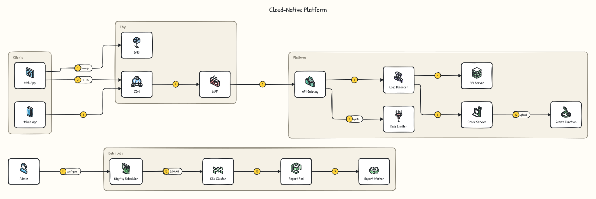

**Smart Commerce Platform** in the midnight theme, with search, recommendations, an AI assistant, payments and an observability pipeline ([spec](examples/smart-commerce.yaml)):

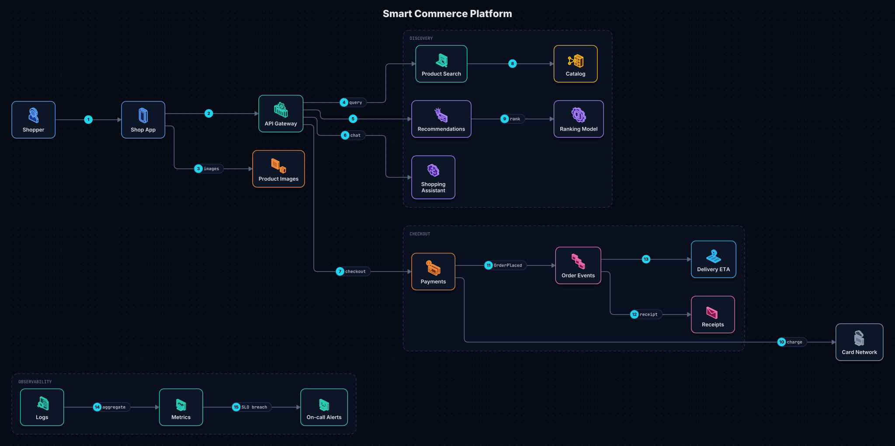

**Secure Data Platform** in the blueprint theme ([spec](examples/secure-data-platform.yaml)):

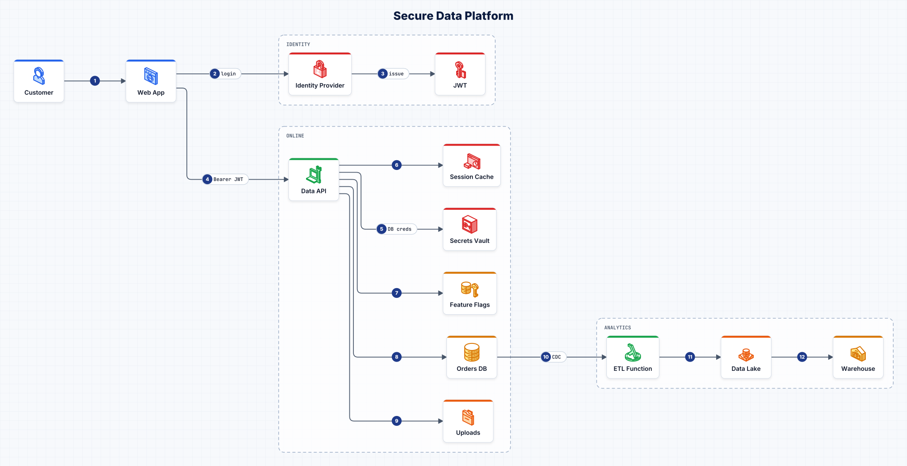

## How it works

```
YAML/JSON spec -> validate (Zod) -> normalize (aliases, labels, steps)
              -> layout (ELK, each independent flow laid out separately)
              -> themed SVG (icons, text as paths) -> optional PNG (resvg)
```

Every stage is a pure function: no randomness, no clock, no browser. That makes output byte-identical across runs, which keeps diffs clean and tests simple.

As a library:

```ts
import { render, renderToFile } from 'sysketch';

const svg = await render('edges: ["client > lb > api > db"]', { theme: 'blueprint' });
await renderToFile(specText, 'diagram.png', { scale: 2 });
```

## Development

```bash
git clone https://github.com/Tonys-Coding/sysketch.git
cd sysketch
npm install
npm run build
npm test             # unit + golden SVG tests
npm run test:e2e     # Playwright visual regression
npm run lint && npm run typecheck
npm run icons        # import icons-src/*.svg and render a preview sheet
```

Packages: `packages/sysketch` (renderer, CLI, library) and `packages/mcp` (MCP server). Inside the repo, `.mcp.json` runs the local MCP build. Releases are published by pushing a `vX.Y.Z` tag (see `.github/workflows/release.yml`).

## Roadmap

- Web playground with live preview

## Credits

Icons and palettes are original. Fonts: Inter, JetBrains Mono, Nunito and Patrick Hand (all SIL Open Font License, see `packages/sysketch/assets/`). Layout by [ELK](https://github.com/kieler/elkjs), PNG export by [resvg](https://github.com/yisibl/resvg-js), sketch style by [rough.js](https://roughjs.com).

License: MIT
