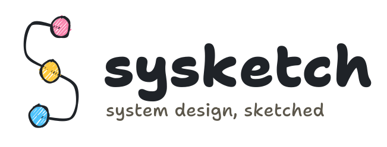
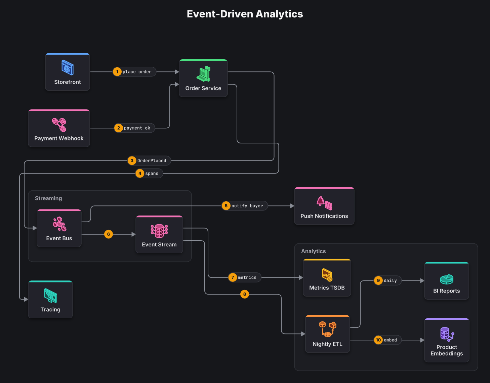
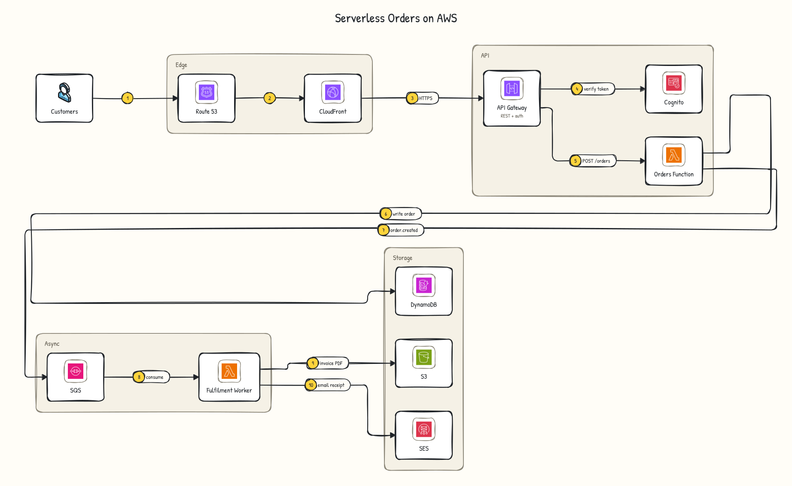

<h1 align="center">
  <picture>
    <source media="(prefers-color-scheme: dark)" srcset="docs/brand/sysketch-logo-dark.svg">
    
  </picture>
</h1>

<p align="center">
  <b>Describe your system in a few lines. Get a clean, hand-sketched architecture diagram.</b><br>
  Works with Claude, Cursor and other AI assistants, or on its own from the command line.
</p>

<p align="center">
  <a href="https://www.npmjs.com/package/sysketch"></a>
  <a href="https://www.npmjs.com/package/sysketch-mcp"></a>
  <a href="https://github.com/Tonys-Coding/sysketch/actions/workflows/ci.yml"></a>
  <a href="LICENSE"></a>
</p>


## Why sysketch

When you ask an AI assistant for a diagram, it usually writes every line, box and coordinate by hand. That is slow, uses up a lot of your AI usage, and every diagram looks different.

With sysketch, the AI writes a short description of your system and sysketch draws it.

- **Faster and cheaper:** 18x fewer AI output tokens and about 9x faster than having the AI draw the image itself ([benchmark](docs/benchmark.md)).
- **Consistent:** every diagram shares the same polished style, icons and layout rules.
- **Easy to change:** "add a cache in front of the database" is a one-line edit, not a redraw.
- **Works anywhere:** SVG or PNG files that look the same in GitHub, Notion, Figma, docs and slides.

## Get started

You need [Node.js](https://nodejs.org) 20 or newer. Nothing else to install.

### With your AI assistant (recommended)

sysketch connects to AI assistants through [MCP](https://modelcontextprotocol.io), the standard way to give them new tools.

**Claude Code:** run this once in your terminal:

```bash
claude mcp add sysketch -- npx -y sysketch-mcp
```

**Claude Desktop, Cursor and other assistants:** add this to the assistant's MCP settings, then restart it:

```json
{
  "mcpServers": {
    "sysketch": { "command": "npx", "args": ["-y", "sysketch-mcp"] }
  }
}
```

Then just ask:

> Use sysketch to draw a ride-sharing app: rider and driver apps, an API gateway, a matching service, a location service and a trip database.

The diagram is saved in your project as an image, along with its short description, so you can ask for changes later ("add a payment service").

### From the command line

Write a description of your system in a file called `diagram.yaml`:

```yaml
title: URL Shortener
groups:
  Backend: [api, cache, db]
edges:
  - client > lb | POST /shorten
  - lb > api
  - api > cache
  - api > db
```

Then draw it:

```bash
npx sysketch render diagram.yaml
```

That creates `diagram.svg`:


Add `--png` for an image file, or `--theme graphite` for a different look.

## Writing a diagram

A diagram has three parts. Only `edges` is required.

| Part     | What it does                        | Example                                   |
| -------- | ----------------------------------- | ----------------------------------------- |
| `edges`  | Arrows between parts of your system | `client > lb > api \| GET /home`          |
| `nodes`  | Optional names, icons and notes     | `api: server \| API Server \| 3 replicas` |
| `groups` | Optional boxes around related parts | `Backend: [api, cache, db]`               |

Common names like `client`, `api`, `db`, `cache`, `queue`, `redis`, `kafka`, `s3` or `stripe` pick the right icon automatically. You can also add dashed arrows for responses, colors, a numbered step legend and more. Everything is in the **[spec guide](docs/spec.md)**.

If something is wrong, sysketch says how to fix it: `unknown node "databse". Did you mean: database?`

## Themes

| Sketch (default)                  | Graphite                              | Blueprint                               | Midnight                              | Classic                             |
| --------------------------------- | ------------------------------------- | --------------------------------------- | ------------------------------------- | ----------------------------------- |
|  |  |  |  |  |

Pick one with `theme: graphite` in your diagram file, or ask your assistant for "the blueprint theme". Every diagram includes [61 original icons](docs/icons.md) that adapt to the theme.

## Examples

<table>
  <tr>
    <td width="50%"><a href="examples/url-shortener-v2.yaml"></a><br><sub><b>URL shortener:</b> subtitles, colored and dashed arrows, step legend</sub></td>
    <td width="50%"><a href="examples/event-analytics.yaml"></a><br><sub><b>Event-driven analytics:</b> a long flow folded into rows</sub></td>
  </tr>
  <tr>
    <td width="50%"><a href="examples/smart-commerce.yaml"></a><br><sub><b>Smart commerce platform</b> in the midnight theme</sub></td>
    <td width="50%"><a href="examples/secure-data-platform.yaml"></a><br><sub><b>Secure data platform</b> in the blueprint theme</sub></td>
  </tr>
</table>

Click any diagram to see the description that produced it. More in [examples/](examples/).

## Official logos (optional)

sysketch can show the real logos of the products in your system, mixed with its own icons and your company's logo. You still write plain names like `kafka` or `spark`; logos you've installed are picked up automatically.


<sub>Acme is a made-up company logo (from a folder next to the diagram). Apache Kafka, Spark, Flink, Airflow and Cassandra logos (Apache License 2.0) and the OpenTelemetry logo (CC BY 4.0) via Simple Icons. Names and logos are trademarks of their owners; sysketch is not affiliated with them. The rest are sysketch icons.</sub>

sysketch doesn't include any company logos; you install them yourself from the official sources. Product logos take one command (`npx sysketch logos install simple-icons`), and your own logos go in a folder next to your diagrams. See the **[logos guide](docs/logos.md)**.

### AWS, Azure and Google Cloud

The cloud providers publish their own architecture icons as downloadable packs, with their own terms, so they're imported separately. Download a pack from [AWS](https://aws.amazon.com/architecture/icons/), [Azure](https://learn.microsoft.com/en-us/azure/architecture/icons/) or [Google Cloud](https://cloud.google.com/icons), then:

```bash
npx sysketch logos import ~/Downloads/<icon-pack>.zip
```

Names like `s3`, `lambda`, `cosmosdb` or `bigquery` then show the official icon:



<sub>Drawn with the official AWS Architecture Icons, unmodified. AWS is a trademark of Amazon; sysketch is not affiliated with or endorsed by AWS.</sub>

## Benchmark

Measured with Claude Code (Sonnet) on 5 system design requests, each with one follow-up edit:

|                            | AI draws the image | AI uses sysketch | Difference   |
| -------------------------- | -----------------: | ---------------: | ------------ |
| Output tokens to create 5  |             77,518 |        **4,352** | 18x fewer    |
| Output tokens for 5 edits  |             28,919 |        **7,746** | 3.7x fewer   |
| Cost of all 10 requests    |              $2.44 |        **$0.95** | 2.6x cheaper |
| Time to create one diagram |              ~99 s |        **~11 s** | ~9x faster   |

Method, prompts and side-by-side images: [docs/benchmark.md](docs/benchmark.md).

## More

- **[Spec guide](docs/spec.md):** everything you can write in a diagram.
- **[Logos guide](docs/logos.md):** product logos, your company's logos, and the AWS, Azure and Google Cloud icon packs.
- **[Icons](docs/icons.md):** the full icon set and how to add your own.
- **Use it in code:** `npm install sysketch`, then `render(spec)` returns the SVG (see the [package README](packages/sysketch/README.md)).
- **[Contributing](CONTRIBUTING.md):** run sysketch from source, tests and releases.
- **[Changelog](CHANGELOG.md)**

## Credits

Icons and color palettes are original. Fonts: Shantell Sans, Inter, JetBrains Mono and Nunito (SIL Open Font License). Layout by [ELK](https://github.com/kieler/elkjs), hand-drawn style by [rough.js](https://roughjs.com), PNG export by [resvg](https://github.com/yisibl/resvg-js).

MIT License.
