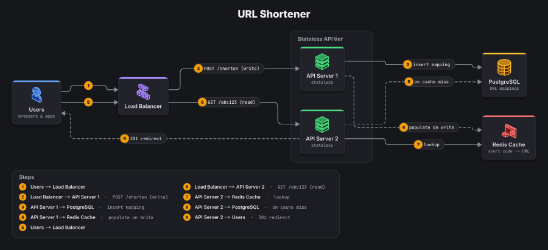
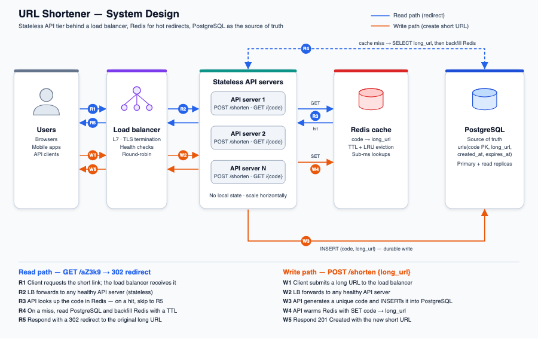
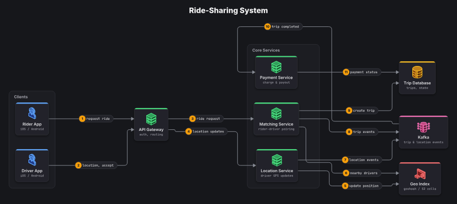
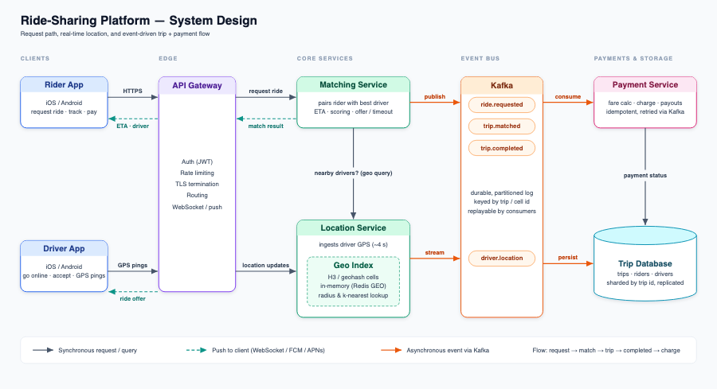
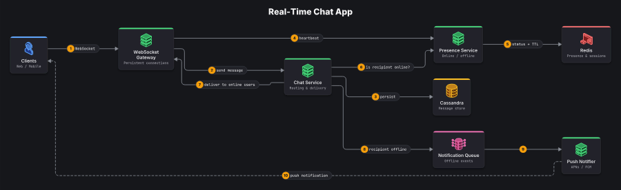
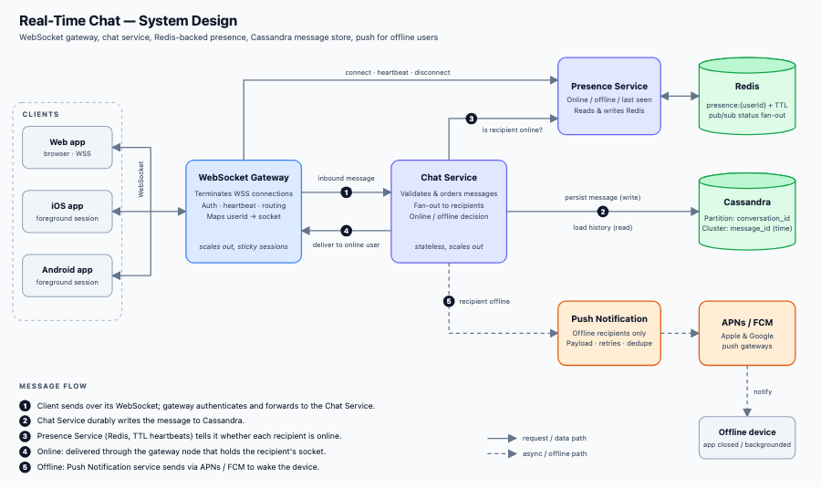
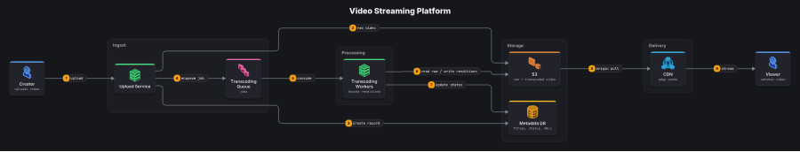
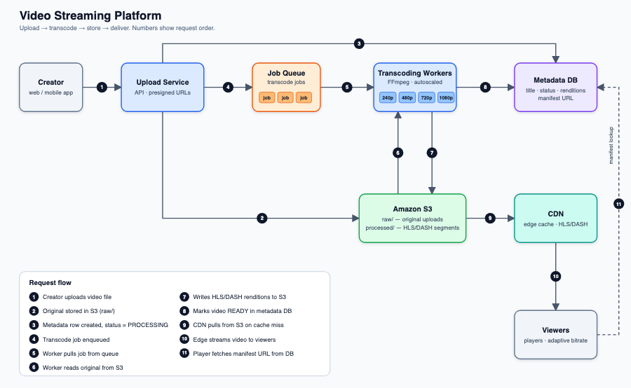
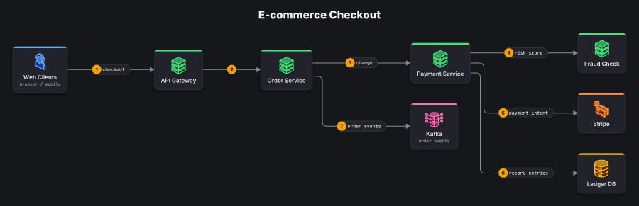
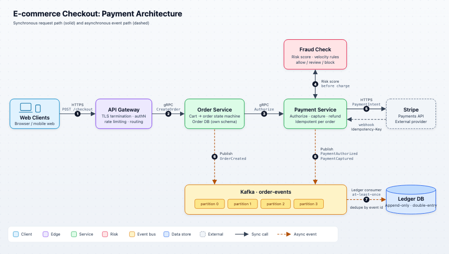

# Token benchmark

The same 5 system design requests, sent to Claude Code (`sonnet`, headless) twice: once with the sysketch MCP server, once asking the model to write the SVG itself. Each run then gets one follow-up edit. sysketch runs measured 2026-10-13, hand-written SVG runs 2026-10-12.

## Results

|                                    |  sysketch | AI writes SVG |   Difference |
| ---------------------------------- | --------: | ------------: | -----------: |
| Output tokens, creating 5 diagrams | **4,352** |        77,518 |  17.8x fewer |
| Output tokens, 5 follow-up edits   | **7,746** |        28,919 |   3.7x fewer |
| Total cost (10 runs each)          | **$0.95** |         $2.44 | 2.6x cheaper |
| Total time                         | **2 min** |        12 min |  5.3x faster |

Output tokens are what the model writes, and they count most against usage limits. Dollar cost differs less than output tokens because every Claude Code session also reads the same fixed context (system prompt, tool definitions), which is billed as cached input.

### Per diagram

| Diagram         | sysketch create | raw create | sysketch edit | raw edit | sysketch file | raw file |
| --------------- | --------------: | ---------: | ------------: | -------: | ------------: | -------: |
| url-shortener   |             839 |     14,713 |         1,476 |    8,844 |       84.6 KB |  10.3 KB |
| ride-sharing    |             914 |     13,912 |         1,291 |    4,663 |       85.9 KB |  10.7 KB |
| chat            |             944 |     20,830 |         1,140 |    6,323 |       84.1 KB |  12.1 KB |
| video-streaming |             908 |     14,415 |         2,513 |    5,723 |       94.1 KB |   8.8 KB |
| payments        |             747 |     13,648 |         1,326 |    3,366 |       58.4 KB |  11.0 KB |

Token counts are output tokens per run (the request and every tool call it took). File sizes are after the edit.

## What each approach drew

First drafts, screenshotted in Chromium. Left: sysketch. Right: the model writing SVG by hand.

**url-shortener**

| sysketch                                                         | AI writes SVG                                              |
| ---------------------------------------------------------------- | ---------------------------------------------------------- |
|  |  |

**ride-sharing**

| sysketch                                                       | AI writes SVG                                            |
| -------------------------------------------------------------- | -------------------------------------------------------- |
|  |  |

**chat**

| sysketch                                       | AI writes SVG                            |
| ---------------------------------------------- | ---------------------------------------- |
|  |  |

**video-streaming**

| sysketch                                                             | AI writes SVG                                                  |
| -------------------------------------------------------------------- | -------------------------------------------------------------- |
|  |  |

**payments**

| sysketch                                               | AI writes SVG                                    |
| ------------------------------------------------------ | ------------------------------------------------ |
|  |  |

## Method

- Claude Code headless (`claude -p --output-format json`), model `sonnet`, one run per prompt and mode.
- sysketch runs: only the sysketch MCP server (`--strict-mcp-config`), tools `render_diagram`, `list_icons`, Read, Edit, Write, Glob. No brand logos installed.
- Raw runs: no MCP servers, tools Read, Edit, Write, Glob.
- Each run starts in an empty temporary folder outside any project, so no CLAUDE.md or memory is loaded. The edit runs in the same folder as its create.
- Prompts: "Create a system design diagram of _topic_", plus "Use the sysketch tools" or "Write it yourself as a polished SVG file". Edit: "Update the _id_ diagram in ./diagrams: _change_".
- Reproduce: `npm run build && node bench/run.mjs && node bench/report.mjs` (needs the Claude Code CLI; set `CLAUDE_BIN` if `claude` is not on PATH). Prompts are in [bench/prompts.json](../bench/prompts.json).

### Prompts

- **url-shortener**: a URL shortener: users, a load balancer, stateless API servers, a Redis cache and a PostgreSQL database. Show the read path and the write path. Edit: add a rate limiter between the load balancer and the API servers.
- **ride-sharing**: a ride-sharing app: rider and driver mobile apps, an API gateway, a matching service, a location service with a geo index, Kafka, a trip database and a payment service. Edit: add a notification service that consumes trip events from Kafka and pushes updates to riders.
- **chat**: a real-time chat app: clients connected over WebSockets to a gateway, a chat service, a presence service backed by Redis, messages stored in Cassandra, and push notifications for offline users. Edit: add a media service that stores uploaded images in object storage behind a CDN.
- **video-streaming**: a video streaming platform: an upload service, a queue of transcoding jobs, transcoding workers, S3 for video files, a metadata database, and a CDN that serves video to viewers. Edit: add a recommendation service that reads watch history and feeds the home page.
- **payments**: an e-commerce checkout: web clients, an API gateway, an order service, a payment service calling Stripe, a fraud check, Kafka order events, and a ledger database. Edit: add an email service that sends receipts when an order is paid.

Single runs vary; treat the per-diagram numbers as indicative and the totals as the headline.
