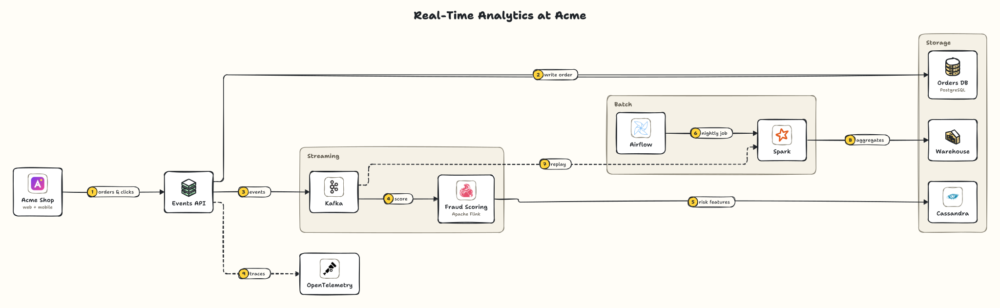
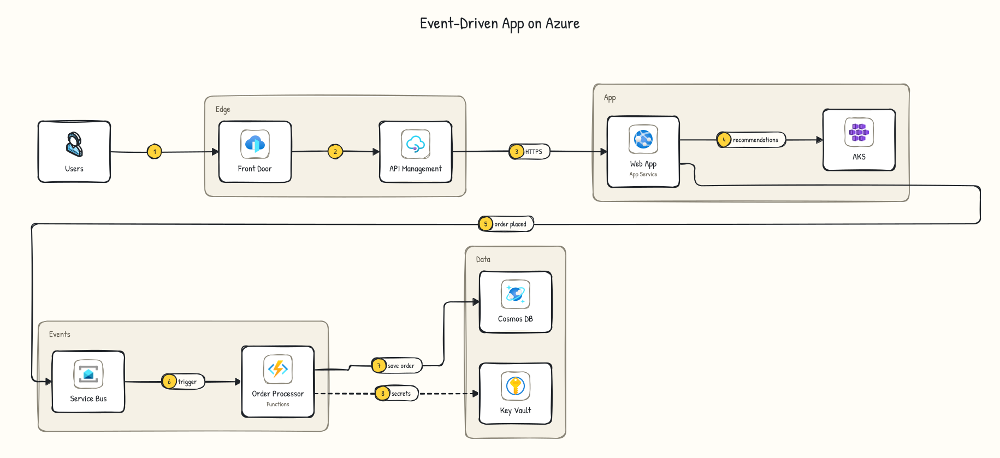

# Logos guide

sysketch can draw the **official logo** of a product (Apache Kafka, Stripe, Amazon S3, Azure Cosmos DB...) or your own company's logo instead of its own icon, and mix all of them in one diagram. Logos are optional, and they don't change how you write diagrams: you still write `kafka` or `s3`.



<sub>Acme is a made-up company logo from [`logos/brand/`](logos/brand). Apache Kafka, Spark, Flink, Airflow and Cassandra logos (Apache License 2.0) and the OpenTelemetry logo (CC BY 4.0) via Simple Icons. Names and logos are trademarks of their owners; sysketch is not affiliated with them. Spec: [mixed.yaml](logos/mixed.yaml).</sub>

## Where logos come from

The sysketch packages don't include any company logos. You install them on your own computer from the official source, and sysketch keeps them in a `.sysketch/logos` folder in your home directory, outside your projects. There are three sources.

### 1. Cloud icon packs (AWS, Azure, Google Cloud)

The cloud providers publish their own icons for architecture diagrams. Download the pack, then import the `.zip` as it is:

| Provider     | Download                                                                                                           |
| ------------ | ------------------------------------------------------------------------------------------------------------------ |
| AWS          | [AWS Architecture Icons](https://aws.amazon.com/architecture/icons/): "Download the asset package"                 |
| Azure        | [Azure icons](https://learn.microsoft.com/en-us/azure/architecture/icons/): accept the terms, "Download SVG icons" |
| Google Cloud | [Google Cloud icons](https://cloud.google.com/icons): "Core products"                                              |

```bash
npx sysketch logos import ~/Downloads/<icon-pack>.zip
```

sysketch recognizes the provider and its file names. Everyday names then work: `s3`, `lambda`, `sqs`, `eks`, `route53` (AWS), `aks`, `cosmosdb`, `keyvault`, `servicebus` (Azure), `bigquery`, `cloudrun`, `gke`, `spanner` (Google Cloud). To update, import a newer pack the same way.

Plain words stay sysketch icons in any diagram, so an AWS diagram's `monitor` or `backup` never turns into an Azure or AWS icon. Most Azure icons have plain names ("Monitor", "Load Balancers"), so write them with the prefix: `azure-monitor`, `azure-load-balancers`. The same goes for AWS and Google Cloud names that are ordinary words (`aws-backup`, `gcp-functions`, `gcp-monitoring`) and for `azure-openai`, so `openai` keeps meaning OpenAI. Any cloud icon also answers to its provider plus its name (`aws-lambda`, `azure-cosmosdb`, `gcp-pubsub`), which helps when a name is also a sysketch icon. Google's older icons are in a separate download ("Legacy icons"); import it as `npx sysketch logos import <zip> --as gcp-legacy` to get Pub/Sub, Firestore, Dataflow and other services the core set leaves out.



<sub>Drawn with the official Azure icons, unmodified. Azure is a trademark of Microsoft; sysketch is not affiliated with or endorsed by Microsoft. Spec: [azure-events.yaml](logos/azure-events.yaml). An AWS example: [aws-serverless.svg](logos/aws-serverless.svg).</sub>

### 2. Product logos (Simple Icons)

[Simple Icons](https://simpleicons.org) collects about 3,400 single-color brand marks. One command downloads them from the official package and checks the download is genuine:

```bash
npx sysketch logos install simple-icons
```

Each mark is drawn in the brand's official color. Some companies (including AWS, Azure and OpenAI) asked Simple Icons not to include them; use their own icon packs instead.

### 3. Your company's logos

Keep your approved logo files (`.svg` or `.png`) in a folder next to your diagrams, and point the diagram at it:

```yaml
logos: ./brand
```

Files are matched by name: `brand/billing.svg` is used for `billing`. To make sure nobody edits a logo by accident, record a fingerprint of every file:

```bash
npx sysketch logos lock ./brand
```

## Which name shows what

| In your diagram                     | With logos installed      | Without logos                   |
| ----------------------------------- | ------------------------- | ------------------------------- |
| `database`, `queue`, `api`, `cdn`   | sysketch icon             | sysketch icon                   |
| `s3`, `redis`, `stripe`, `sendgrid` | the official logo         | a fitting sysketch icon         |
| `acme/queue`                        | Acme's logo, if installed | the `queue` icon labeled "Acme" |
| `db: database \| DynamoDB`          | the product's logo        | the `database` icon             |

A node that picks a generic icon but is named after a product, by its label (`db: database | DynamoDB`) or by an id sysketch knows as a product (`cognito: server | Auth`), still gets the product's logo. Generic names always keep the sysketch icon. Because every product name has a fallback, the same diagram works on any computer.

## Logos stay original

- Files are stored exactly as published and fingerprinted when installed.
- Before drawing, sysketch checks the fingerprint again and refuses a logo that was changed.
- Logos are placed as-is on a neutral tile: never recolored, stretched or restyled by the theme.

## Using logos responsibly

Logos belong to their owners. Before publishing a diagram that shows them:

- Check the brand's rules. `npx sysketch logos info stripe` shows the license, brand guidelines and original artwork link when known.
- Don't use logos in a way that suggests a company endorses you.
- Don't commit downloaded icon packs to a public repository; each person installs their own.

The examples in this repository only use logos that are clearly fine to publish: the AWS and Azure icon packs (made for architecture diagrams), Simple Icons marks published under open licenses, and a made-up company logo.

## On the hosted server

The [AI chat connector](../README.md#in-your-ai-chat-nothing-to-install) (`https://sysketch.vercel.app/mcp`) includes the latest Simple Icons logos, the official AWS, Azure and Google Cloud architecture icons (Google's core and legacy packs) and OpenAI's Blossom mark from [OpenAI's brand page](https://openai.com/brand/) for `openai` and `chatgpt`, all drawn unaltered and only inside diagrams. Specs can't point it at logo folders; use the local version for your company's logos. Brand owners can ask for a logo to be removed by [opening an issue](https://github.com/Tonys-Coding/sysketch/issues).

## Commands

```bash
npx sysketch logos                         # list installed sources
npx sysketch logos find s3                 # search installed logos
npx sysketch logos info stripe             # license, guidelines and source of one logo
npx sysketch logos remove simple-icons     # remove a source
```

`npx sysketch render diagram.yaml --no-logos` draws without logos. In a diagram file, `logos: false` does the same.
